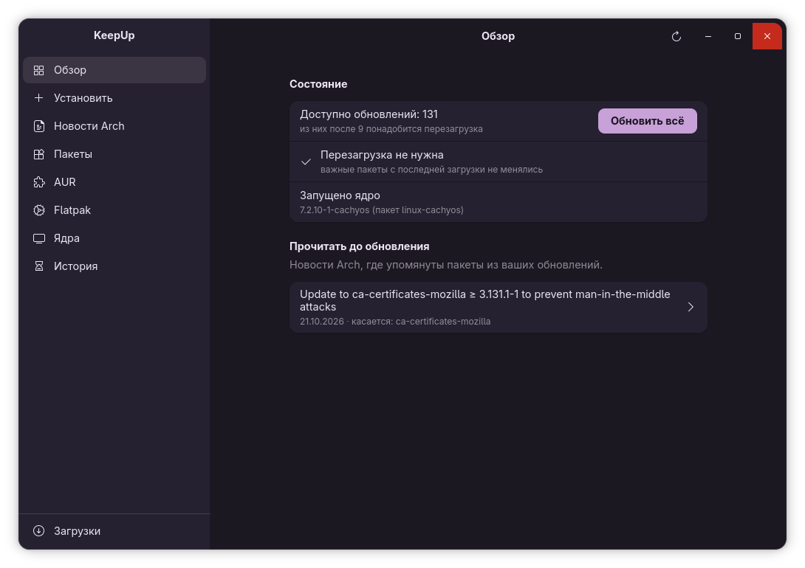
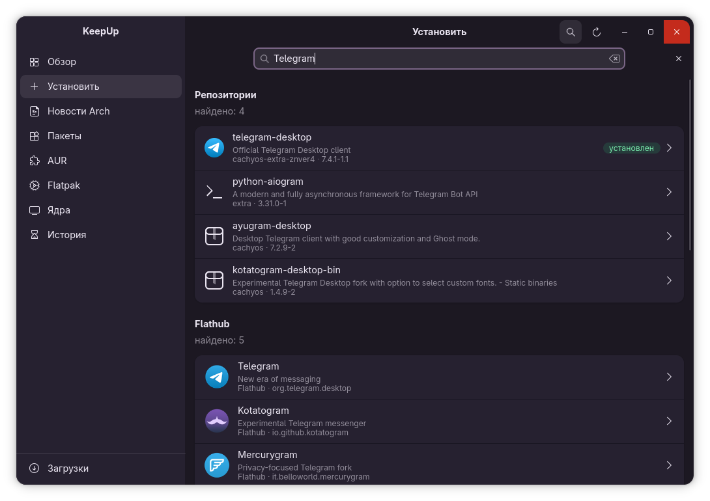
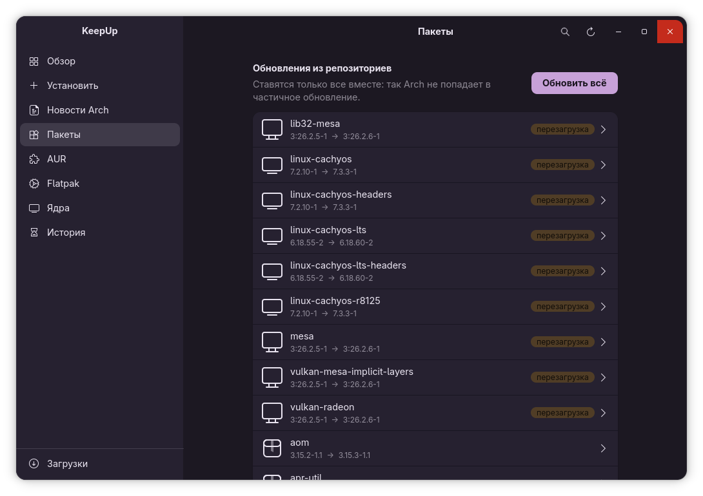
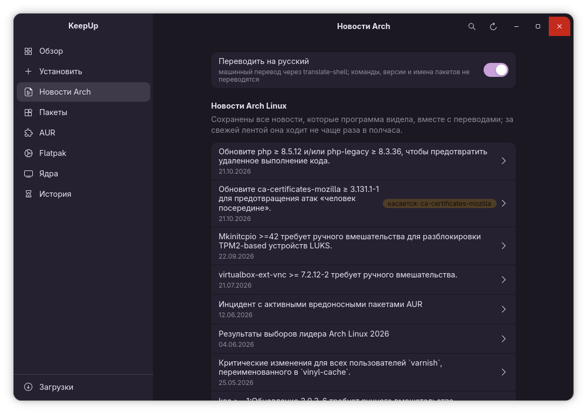
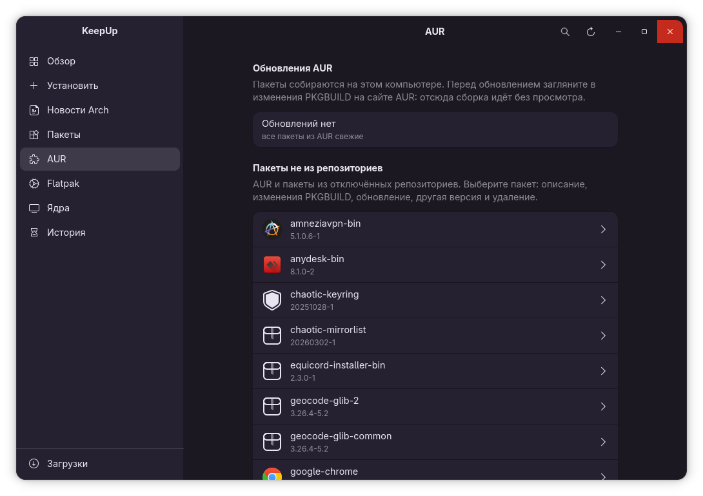
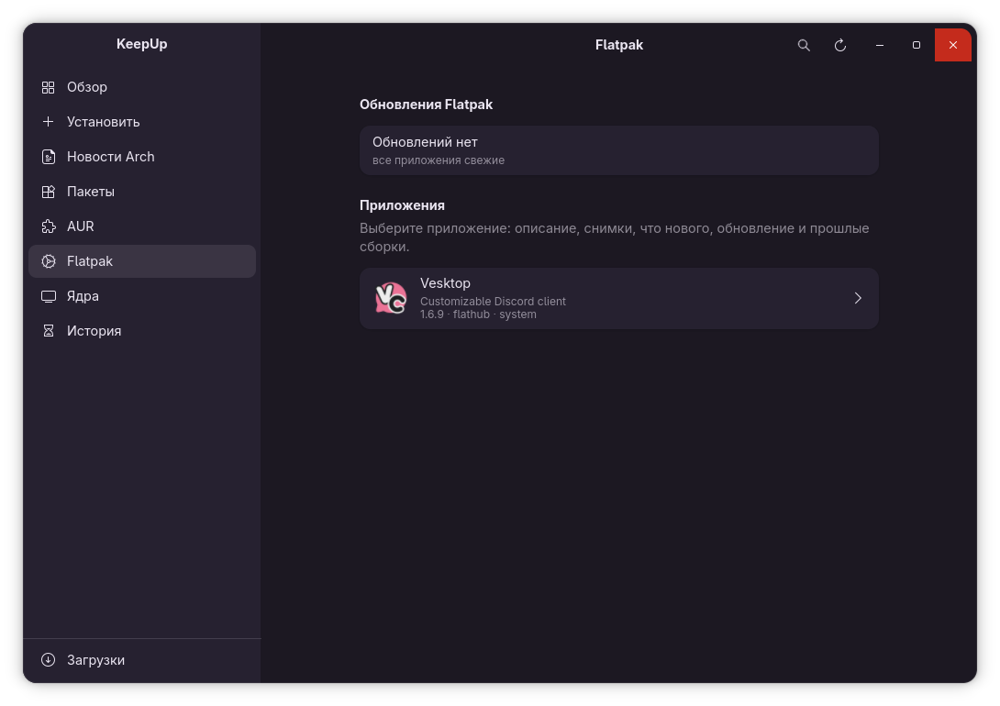
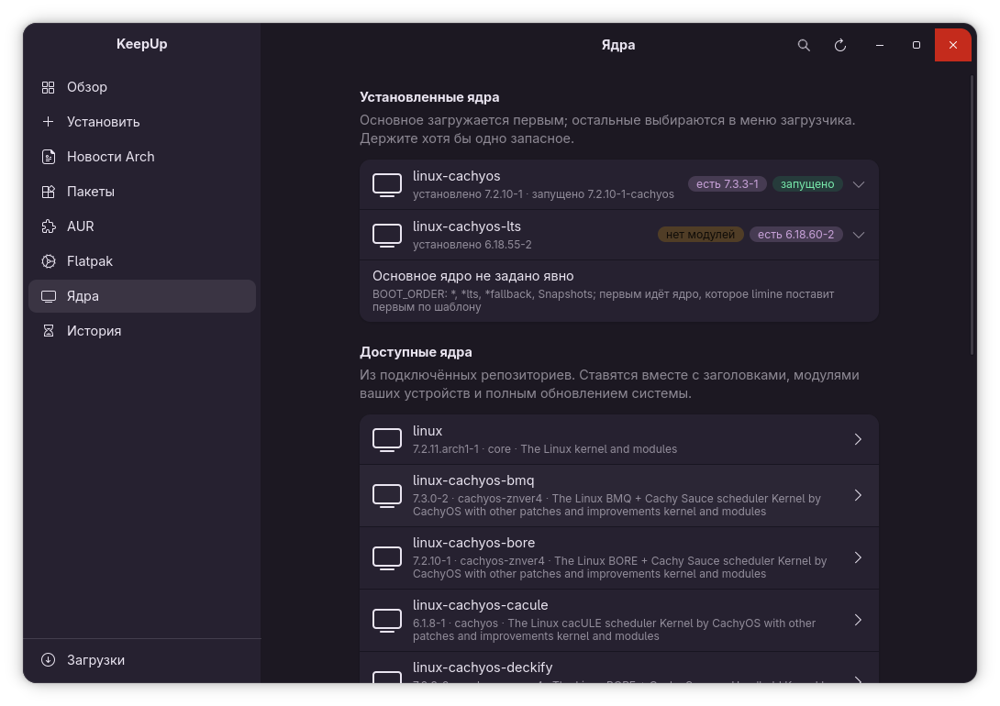
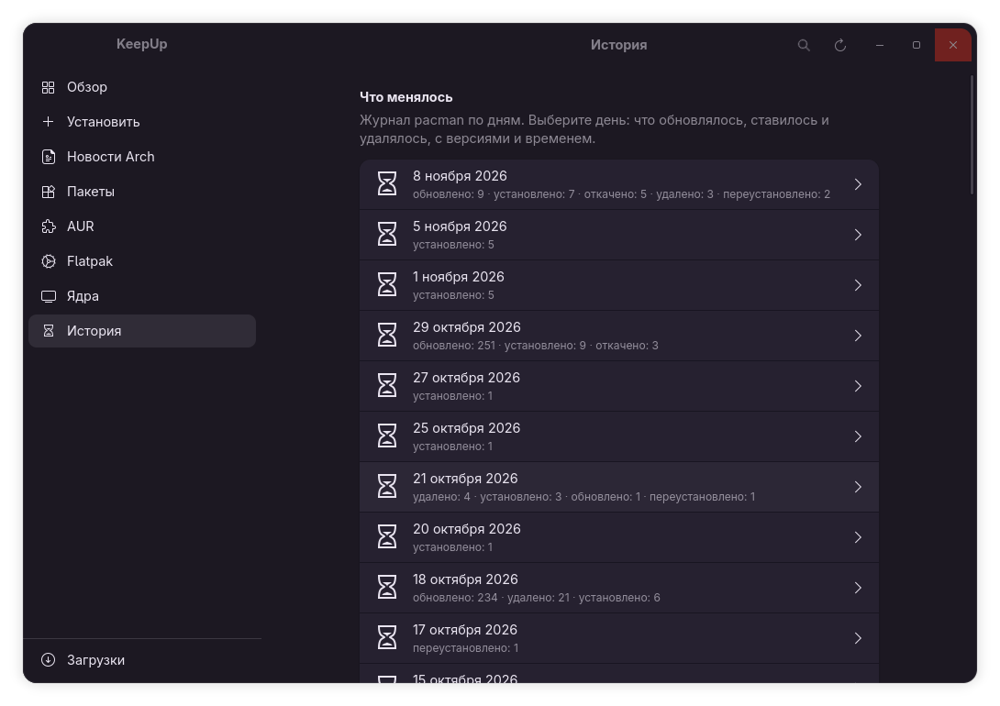

<p align="center"></p>

<h1 align="center">KeepUp</h1>

<p align="center">
  Окно обновлений для Arch Linux и CachyOS в стиле GNOME<br>
  <sub>GNOME-style update manager for Arch Linux and CachyOS · <a href="#english">English below</a></sub>
</p>

<p align="center">
  <a href="https://github.com/vw6/keepup/releases/latest"></a>
  
  
</p>

<p align="center"></p>

## О проекте

Это в первую очередь личный проект: я сделал его для себя, чтобы обновлять свою систему не из консоли и спокойно откатывать то, что не понравилось. Выкладываю как есть. Развитие, исправления и ответы на вопросы не гарантируются, хотя замечания и правки приветствуются.

Программа написана примерно за час вместе с Claude Opus 5.5 (Anthropic): я ставил задачи и проверял результат, модель писала код. Это прототип на Python; если он приживётся, его планируется переписать на Rust.

## Что умеет

На вкладке «Обзор» видно, сколько обновлений ждёт в репозиториях, AUR и Flatpak, нужна ли перезагрузка и какие новости Arch стоит прочитать до обновления. Новости Arch показываются с пометкой, если касаются ваших пакетов, переводятся на русский через translate-shell (команды, версии и имена пакетов не переводятся) и сохраняются локально вместе с переводом.

Вкладка «Установить» ищет то, чего ещё нет в системе, сразу в трёх местах: в репозиториях, на Flathub и в AUR. Пакет открывается такой же карточкой, с описанием, размером, зависимостями, а у приложений Flathub и снимками экрана. Пакет из репозитория ставится ровно той версии, что в свежих списках, вместе с нужными ему пакетами; если для него нужны более новые общие библиотеки, программа предложит поставить его вместе с обновлением всей системы. Пакеты AUR собирает paru, и перед сборкой можно открыть PKGBUILD.

У каждого пакета, из репозиториев или из AUR, и у каждого приложения Flatpak есть своя страница: описание, снимки экрана, история версий и примечания к выпуску из самой программы, выпусков GitHub или каталога Flathub. Отсюда можно обновить один пакет, если это не тянет обновление общих библиотек, поставить любую прошлую версию из кэша pacman, архива Arch или правки PKGBUILD в AUR, удалить пакет. Пакеты одной сборки (например, все части mesa) ставятся и откатываются только вместе.

Вкладка «Ядра» показывает установленные и доступные ядра, ставит ядро вместе с заголовками и модулями ваших устройств, подсказывает, если у запасного ядра не хватает модуля, и выбирает основное ядро в загрузчике Limine. Вкладка «История» раскладывает журнал pacman по дням.

Все действия с правами root идут через стандартное окно пароля (pkexec). Пароль программа не видит.

## Как это выглядит

<table>
  <tr>
    <td width="50%"><br><b>Установить.</b> Поиск сразу по репозиториям, Flathub и AUR, уже установленное помечено.</td>
    <td width="50%"><br><b>Пакеты.</b> Обновления из репозиториев, пометка, где после обновления нужна перезагрузка.</td>
  </tr>
  <tr>
    <td><br><b>Новости Arch.</b> С переводом на русский и пометкой, если новость касается ваших пакетов.</td>
    <td><br><b>AUR.</b> Пакеты не из репозиториев: изменения PKGBUILD, сборка любой прошлой версии.</td>
  </tr>
  <tr>
    <td><br><b>Flatpak.</b> Приложения с описанием, снимками, примечаниями и прошлыми сборками.</td>
    <td><br><b>Ядра.</b> Установленные и доступные ядра, модули устройств, основное ядро в Limine.</td>
  </tr>
  <tr>
    <td colspan="2" align="center"><br><b>История.</b> Журнал pacman по дням: что обновлялось, ставилось и удалялось.</td>
  </tr>
</table>

## Установка

Из AUR:

```
paru -S keepup
```

Из исходников:

```
make install DESTDIR=/ PREFIX=/usr
```

Нужны python 3.10 или новее, python-gobject, gtk4 4.10 или новее, libadwaita 1.7 или новее, pacman-contrib и polkit. Необязательно: paru для AUR, flatpak, translate-shell для перевода новостей, git и base-devel для сборки прошлых версий из AUR, limine-mkinitcpio-hook для выбора основного ядра.

Для разработки: `./run.sh` запускает программу из каталога проекта, `./run.sh --page aur` открывает сразу нужную вкладку, `KEEPUP_SEPARATE=1` запускает второй экземпляр рядом с уже открытым окном, проверки запускаются командой `make test`. Данные программы лежат в `~/.cache/keepup`, `~/.local/share/keepup` (архив новостей с переводами) и `~/.config/keepup`.

## Перевод

Все надписи программы лежат в `keepup/locales`, по файлу JSON на язык. Основной язык русский (`ru_RU.json`). Чтобы перевести KeepUp, скопируйте его под именем своего языка, например `en_US.json` или `de_DE.json`, переведите значения и пришлите правкой на GitHub. Ключи не меняются, а слова в фигурных скобках, например `{name}` или `{count}`, программа подставляет сама, их нужно оставить как есть. Язык выбирается по настройкам системы; строки, которых в переводе ещё нет, показываются по-русски. Проверить перевод можно запуском `KEEPUP_LANG=en_US ./run.sh`, а `make test` проверит, что ключи и подстановки совпадают с основным файлом.

## Лицензия

[Mozilla Public License 2.0](LICENSE). Код можно свободно использовать, менять и включать в свои проекты, в том числе закрытые. Если вы распространяете изменённые файлы KeepUp, их исходный код нужно открыть под той же лицензией.

---

<a id="english"></a>

## English

See the screenshots above; the interface is available in Russian and English.

KeepUp is a GNOME-style update manager for Arch Linux and CachyOS: search and install from the repositories, Flathub and AUR, pending updates from the repositories, AUR and Flatpak, Arch news with optional machine translation and an offline archive, a page for every package with release notes, rollback to any previous version (pacman cache, Arch Linux Archive or an AUR commit), kernel management with Limine, and pacman history by day.

This is primarily a personal project, published as is. Further development, fixes and support are not guaranteed. It was written in about an hour together with Claude Opus 5.5 (Anthropic) as a Python prototype that may later be rewritten in Rust.

All interface strings live in `keepup/locales`, one JSON file per language, with Russian (`ru_RU.json`) as the base. To translate KeepUp, copy it to your language (for example `en_US.json`), translate the values, keep the `{placeholders}` as they are and send a pull request. Missing strings fall back to Russian; `KEEPUP_LANG=en_US ./run.sh` previews a translation and `make test` checks keys and placeholders.

Licensed under the [Mozilla Public License 2.0](LICENSE): free to use, modify and include in other projects, including proprietary ones; modified KeepUp files must be published under the same license when distributed.
